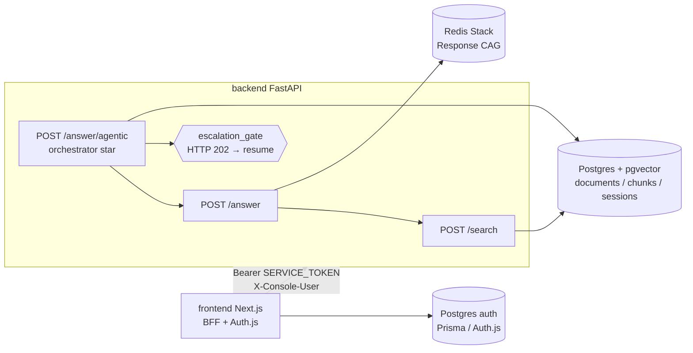

# Entrega LiDR — Plataforma multiagente con RAG

Entrega del [Máster en AI Engineering de LIDR](https://www.lidr.co/ai-engineering/): una **plataforma multiagente con RAG**.

El **cliente** de la entrega es **Metropol Fintech**. Su documentación de negocio y sistemas (omnicanalidad, ventas, cobranzas, Tenela, etc.) es el **corpus del RAG** — conocimiento indexado para que los agentes respondan y razonen con contexto real. Esa documentación **no** es el software que se entrega en este repo.

Monorepo de dos proyectos:

| | qué es | stack | se despliega en |
|---|---|---|---|
| [`backend/`](backend/README.md) | ingesta, chunking, embeddings, retrieval, answer sync/agentic, CAG | Python · FastAPI · pgvector · Redis · LangGraph | Railway |
| [`frontend/`](frontend/README.md) | consola: login, chat agentic, search, ingest, agents, users | Next.js · Auth.js · Prisma · Astryx | Vercel |

## Arquitectura



Tres formas de llegar al retrieval, con costo y control crecientes:

- `POST /search` — chunks rankeados, sin sintetizar.
- `POST /answer` — un tiro: retrieve → presupuesto → pack Metropol + Jinja → LLM → citas.
- `POST /answer/agentic` — grafo LangGraph (escalera `intent_framer` → `corpus_fetcher` → customs → `grounded_composer` → `source_guard`) con hub orquestador y gate humano si la confianza es baja, no hay evidencia o las citas no cierran. Variante `/start` + `/{thread_id}/progress` para narrar nodos en la consola.

**No se entrena un modelo.** El corpus se **ingere** (parse → chunk → embedding OpenAI → filas en Postgres). Cambiar el chunker exige re-ingerir (`--force`); cambiar el embedding model reconstruye el índice.

## Empezar (local)

Guía completa: [`docs/local-setup.md`](docs/local-setup.md).

```bash
cp .env.example .env                    # Postgres / pgAdmin
docker compose up -d                    # Postgres + Redis + pgAdmin

cd backend && cp .env.example .env      # DATABASE_URL + OPENAI_API_KEY
python3.12 -m venv .venv && source .venv/bin/activate
pip install -r requirements.txt
alembic upgrade head
uvicorn app.main:app --reload

cd frontend && cp .env.example .env.local
# CREATE DATABASE entrega_lidr_auth;  (ver docs/local-setup.md)
npm install && npm run db:migrate && npm run seed:admin
npm run dev
```

Detalle de cada lado: [`backend/README.md`](backend/README.md), [`frontend/README.md`](frontend/README.md).  
Instrucciones para agentes de código: [`AGENTS.md`](AGENTS.md) (raíz) y [`frontend/AGENTS.md`](frontend/AGENTS.md).

## Cliente: Metropol Fintech

Financiera de préstamos (MooviTech / Grupo Metropol). Dominios relevantes:

- **Ventas** — captación, recurrentes, ofertas, dictamen, solicitudes.
- **Cobranzas** — avisos de pago, medios, planes, promesas, quitas.
- **Operación omnicanal** — WhatsApp, campañas, handoff a humanos.
- **Core Tenela** — identidad, dictamen, simulación de préstamo, gestiones.

> El cliente es Metropol **Fintech**, no una empresa de transporte.

### Documentación del cliente = corpus RAG

Fuente (no código de esta entrega):

- Carpeta local: *Metropol Fintech - Omnicanalidad (Agentes)* → `CORPUS_ROOT` en `backend/.env`
- Notebook: [Metropol Fintech (NotebookLM)](https://notebooklm.google.com/notebook/15d6ea8b-2036-4548-8f8a-cf7aefb81d59)

Mencionar Chatwoot, Rasa o Mautic en el corpus es el **mundo del cliente**, no dependencias de este monorepo.

## Autenticación (dual)

| Capa | Qué protege |
|------|-------------|
| **Auth.js + Prisma** (frontend) | Personas en la consola (credentials; registro → disabled hasta admin) |
| **SERVICE_TOKEN** (backend) | Llamadas machine-to-machine; el BFF de Next adjunta `Authorization: Bearer …` |
| **X-Console-User** | Ownership de sesiones de chat (transcript por operador) |

Con `APP_ENV=production` y `SERVICE_TOKEN` vacío el API **no arranca**. Generar token:

```bash
python -c "import secrets; print(secrets.token_urlsafe(32))"
```

El mismo valor va en Railway (`SERVICE_TOKEN`) y en Vercel (`SERVICE_TOKEN`). Nunca `NEXT_PUBLIC_`.

## Despliegue (evidencia de entrega)

Guía operativa: [`docs/deploy-railway-vercel.md`](docs/deploy-railway-vercel.md).  
Puesta en marcha local: [`docs/local-setup.md`](docs/local-setup.md).

| | URL pública |
|---|---|
| **Consola (Vercel)** | https://lidr-metropol-console.vercel.app |
| **API (Railway)** | https://api-production-24b7.up.railway.app |
| Healthcheck API | https://api-production-24b7.up.railway.app/api/v1/health |

Proyecto Railway: **LIDR-Infra** (Postgres + pgvector, Redis Stack, servicio `api`).  
Corpus Metropol ingerido en prod (chunks + embeddings en pgvector; los archivos del cliente no están en el repo).

Login consola: registro credentials + admin seed (cuenta demo bajo control del equipo; no se publican passwords en el README).

| | Railway (`backend/`) | Vercel (`frontend/`) |
|---|---|---|
| root directory | `backend` (o snapshot local vía `railway up --path-as-root`) | `frontend` |
| build | `backend/Dockerfile` | Next.js (`npm run build` → `prisma generate`) |
| healthcheck | `GET /api/v1/health` | — |
| migraciones | `alembic upgrade head` al arrancar el contenedor | `npm run db:migrate` a mano |
| variables críticas | `DATABASE_URL`, `REDIS_URL`, `OPENAI_API_KEY`, `SERVICE_TOKEN`, `CORS_ORIGINS`, `APP_ENV=production` | `AI_SERVICE_URL`, `SERVICE_TOKEN`, `AUTH_SECRET`, `AUTH_URL`, `AUTH_DATABASE_URL` |

**Orden:** primero Vercel (consola arriba), después cerrar Railway con token + CORS al origen Vercel. Al revés, la consola recibe 401 hasta que Vercel tenga el token.

**Corpus en prod:** no vive en el repo ni en un volume. Tras el deploy, desde tu máquina:

```bash
# DATABASE_URL = Postgres público de Railway (RAG)
# CORPUS_ROOT = carpeta local Metropol
cd backend && source .venv/bin/activate
python -m app.ingestion.run_ingest
```

## Los datos NO están en el repo

El corpus del cliente y los `.env` reales están gitignoreados. El repo trae el pipeline (parse, chunk, embed, search, answer), no los PDF/DOCX de Metropol.

## Fuente de verdad

- **`openspec/specs/<capability>/spec.md`** — qué hace el sistema **hoy** (normativo).
- **`openspec/changes/`** / **`archive/`** — trabajo en curso y el *por qué* de decisiones pasadas.
- **`openspec/drafts/`** — borradores locales de `/opsx-prespec`; **no se versionan** (ver `.gitignore`).

## Limitaciones conocidas

- Activity/progress log agentic es **in-process** (se pierde al redeploy; pause/resume del checkpointer Postgres sí sobrevive).
- Items CRUD de demo sigue en memoria.
- Google OAuth deferido; consola = credentials + alta admin.
- Quien tenga el `SERVICE_TOKEN` puede llamar al API sin tope de gasto por usuario.
- Un commit que toca un solo lado puede redesplegar el otro si no se configuran Watch Paths (Railway) / Ignored Build Step (Vercel).

## Fuentes

- [Máster AI Engineering — LIDR](https://www.lidr.co/ai-engineering/)
- Docs del cliente + [NotebookLM Metropol Fintech](https://notebooklm.google.com/notebook/15d6ea8b-2036-4548-8f8a-cf7aefb81d59)
