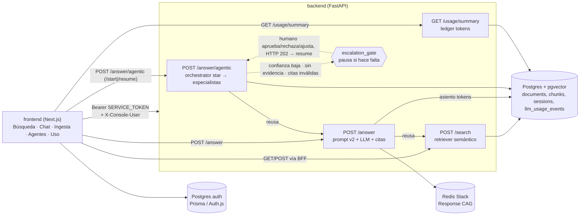

# Metropol Fintech RAG

Proyecto final del [Master en AI Engineering (LIDR)](https://www.lidr.co/ai-engineering/).
Un RAG multiagente sobre la documentación de omnicanalidad y agentes del cliente
**Metropol Fintech** (financiera de préstamos, MooviTech / Grupo Metropol):
ventas, cobranzas, operación WhatsApp/campañas, handoff y core **Tenela**.
Los documentos se parsean, trocean, embeben e indexan en pgvector para
preguntarles en lenguaje natural con citas y, cuando hace falta, revisión humana.

Esa documentación del cliente **no** es el software de esta entrega: el repo
trae el pipeline y la consola, no los PDF/DOCX. Mencionar Chatwoot, Rasa o
Mautic en el corpus es hablar del **mundo del cliente**, no de dependencias
del monorepo. El cliente es Metropol **Fintech**, no una empresa de transporte.

Monorepo de dos proyectos, el layout que fija el programa:

| | qué es | stack | se despliega en |
|---|---|---|---|
| [`backend/`](backend/README.md) | ingesta, chunking, embeddings, retrieval, answer sync/agentic, CAG, LangGraph, **ledger de tokens** | Python · FastAPI · pgvector · Redis | Railway |
| [`frontend/`](frontend/README.md) | consola: login, chat agentic, búsqueda, ingesta, agentes, users, **uso** | Next.js · Auth.js · Prisma · Astryx | Vercel |

## Arquitectura



Tres formas de llegar al mismo pipeline de recuperación, con costo y control
crecientes: `/search` devuelve chunks sin interpretarlos, `/answer` los
sintetiza en una respuesta citada de un solo paso (Knowledge CAG + Response
CAG + prompts Jinja `ANSWER_PROMPT_VERSION=v2`), y `/answer/agentic` la
envuelve en un grafo LangGraph con topología **star**: el hub `orchestrator`
elige el siguiente especialista con una escalera determinista
(`intent_framer` → `corpus_fetcher` → customs opcionales vía
`prompt_specialist` → `grounded_composer` → `source_guard`) y vuelve al hub
tras cada uno; al cerrar la escalera va al `escalation_gate`. El gate **no**
pausa siempre: solo cuando la confianza queda bajo umbral, no hay evidencia,
o las citas no cierran contra los hits. `/answer/agentic` tiene además
`/start` + `/{thread_id}/progress` que corre en background y narra nodos por
polling, para que la consola muestre el grafo trabajando en vez de una
pantalla en blanco.

La consola tiene una pantalla de **agentes** (`GET /api/v1/answer/agents`):
builtins (read-only; prompt Jinja del composer) y customs en Postgres que
entran al ladder cuando están enabled. Domain tag Metropol
(`ventas|cobranzas|operacion|tenela|general`) **no** es un agente aparte: es
una etiqueta de negocio para framing/retrieve.

Los **embeddings no son multi-proveedor**: el corpus vive en el espacio de
`text-embedding-3-small` (1536-d) y cambiarlo sería reconstruirlo. El chat sí
admite override en runtime (`PUT /config/models`, allowlist + Redis) sin
redeploy. **No se entrena un modelo**: se ingeren embeddings; re-chunking
exige `run_ingest --force`.

Hay dos identidades de conversación que no hay que mezclar:

| Concepto | Qué es |
|----------|--------|
| `session_id` | Transcript durable en Postgres; agrupa muchos runs; ownership por `X-Console-User` |
| `thread_id` | Estado pausado de **un** run LangGraph (checkpointer Postgres) |
| Conversation memory | Con `session_id`, resuelve follow-ups **antes del retrieve** y mete una ventana de turnos en el prompt (no es evidencia citable) |

`POST /answer` (sync) **rechaza** `session_id` con 422: no miente con memoria
que no tiene. El detalle de capas, ingest y eval está en el
[README del backend](backend/README.md).

## Empezar

Guía paso a paso: [`docs/local-setup.md`](docs/local-setup.md).

Postgres + Redis viven en el compose de la **raíz** a propósito: el nombre del
proyecto Compose sale del directorio del archivo; moverlo renombraría el
volumen y levantaría una base vacía sin decir nada.

```bash
cp .env.example .env
docker compose up -d
```

```bash
cd backend
cp .env.example .env          # DATABASE_URL, OPENAI_API_KEY, CORPUS_ROOT, …
python3.12 -m venv .venv && source .venv/bin/activate
pip install -r requirements.txt
alembic upgrade head
uvicorn app.main:app --reload
```

```bash
cd frontend
cp .env.example .env.local    # AUTH_*, AI_SERVICE_URL, SERVICE_TOKEN
# CREATE DATABASE entrega_lidr_auth;  — ver docs/local-setup.md
npm install && npm run db:migrate && npm run seed:admin
npm run dev
```

El detalle de cada proyecto está en su propio README: el
[del API](backend/README.md) —pipeline, agentic, ingest, Docker— y el
[de la consola](frontend/README.md). Instrucciones para agentes de código:
[`AGENTS.md`](AGENTS.md) y [`frontend/AGENTS.md`](frontend/AGENTS.md).

## Despliegue

| | URL |
|---|---|
| Consola | https://lidr-metropol-console.vercel.app |
| API | https://api-production-24b7.up.railway.app |
| Health | https://api-production-24b7.up.railway.app/api/v1/health |

La consola pide sesión Auth.js; el servicio pide `SERVICE_TOKEN` en todo menos
`/api/v1/health`. Verificado el 2026-10-13. Proyecto Railway: **LIDR-Infra**
(Postgres + pgvector, Redis Stack, servicio `api`). Corpus ingerido en prod
(~75 documentos / ~437 chunks con embedding); los archivos del cliente no
suben al servidor — el ingest corre desde la máquina del operador contra el
`DATABASE_URL` público.

Guía greenfield: [`docs/deploy-railway-vercel.md`](docs/deploy-railway-vercel.md).

Cada proyecto va a su plataforma, y cada plataforma despliega desde GitHub (o
`railway up` del `backend/`) por su propia integración. **No hay ningún job de
CI que despliegue**: reproducirlo sería reimplementar en YAML lo que las dos ya
hacen, con rollback incluido.

| | Railway (`backend/`) | Vercel (`frontend/`) |
|---|---|---|
| root directory | `backend` (o snapshot `railway up --path-as-root`) | `frontend` |
| build | [`backend/Dockerfile`](backend/Dockerfile) | Next.js (`npm run build` → `prisma generate`) |
| healthcheck | `GET /api/v1/health` | — |
| migraciones | `alembic upgrade head` al arrancar el contenedor | `npm run db:migrate`, a mano |
| variables | `DATABASE_URL`, `REDIS_URL`, `OPENAI_API_KEY`, `SERVICE_TOKEN`, `CORS_ORIGINS`, `APP_ENV=production` | `AI_SERVICE_URL`, `SERVICE_TOKEN`, `AUTH_SECRET`, `AUTH_URL`, `AUTH_DATABASE_URL` |
| no redesplegar de más | *Watch Paths* / patrones del servicio | *Ignored Build Step* si el commit no toca `frontend/` |

El detalle de cada variable —qué rompe si falta— está en los dos
[`.env.example`](backend/.env.example) / [`frontend/.env.example`](frontend/.env.example),
que son el lugar donde vive esa explicación.

`AI_SERVICE_URL` es la URL pública del API en Railway, y es **privada**: sin
prefijo `NEXT_PUBLIC_`, porque el browser nunca la tiene que poder leer. Toda
llamada al servicio sale del servidor de Next (BFF + `SERVICE_TOKEN` +
`X-Console-User`).

`SERVICE_TOKEN` en Railway y en Vercel es **el mismo valor**: el secreto
compartido que el API exige en cada llamada. El servicio se despliega con URL
pública, así que sin esto le contesta a cualquiera —y con `APP_ENV=production`
y la variable vacía **no arranca**, porque una auth que un despliegue se
olvidó de configurar es peor que ninguna. Uno distinto por entorno:

```bash
python -c "import secrets; print(secrets.token_urlsafe(32))"
```

**El orden importa: primero Vercel, después cerrar Railway con token + CORS.**
Un header Bearer hacia un API todavía abierto se ignora; al revés, la consola
queda con 401 hasta que Vercel tenga el token. `/api/v1/health` no lleva token
—es el healthcheck— y es el único endpoint abierto.

**Las migraciones no se aplican igual en los dos lados, y es a propósito.** El
API migra al arrancar: su deploy corre como una sola instancia, así que no hay
dos procesos compitiendo por el lock de Alembic. La consola no tiene esa
propiedad —Vercel construye en cada commit—, así que `prisma migrate deploy`
es un acto deliberado (`npm run db:migrate` contra `AUTH_DATABASE_URL`) y no
un paso del build que tumba el deploy entero cuando la base está un segundo
inalcanzable.

### Dos pasos que no viven en el repo

Sin ellos el despliegue queda arriba y nadie puede entrar:

1. **Auth DB + migrate.** Segunda database en el mismo Postgres de Railway
   (`entrega_lidr_auth` o el nombre que elijan) y `npm run db:migrate` desde
   `frontend/` apuntando a esa URL.
2. **El alta del primer usuario.** La consola **no auto-habilita** registros:
   el self-signup crea cuentas *disabled* hasta que un admin las active en
   `/users`. `npm run seed:admin` crea el primer administrador.

Corpus en prod (una vez):

```bash
cd backend && source .venv/bin/activate
# DATABASE_URL = Postgres RAG público de Railway
# CORPUS_ROOT = carpeta local Metropol
python -m app.ingestion.run_ingest
```

## Los datos NO están en el repo

`CORPUS_ROOT` apunta a una carpeta local gitignoreada. Contiene documentación
de negocio y sistemas que **pertenecen al cliente**, más lo que el pipeline
genera al ingerir. El repo trae el pipeline (parse, chunk, embed, search,
answer), no los datos.

## Limitaciones conocidas y próximos pasos

- **Recuperación**: semántica densa sobre chunks (sin hybrid/RRF del peer
  todavía). Vacío de corpus → `200` con `results: []`; sin
  `OPENAI_API_KEY` → `503`.
- **Generación sync**: Response CAG (exacta + semántica en log-only por
  defecto); al cambiar prompts/`ANSWER_PROMPT_VERSION` hay que flush Redis o
  las claves exactas sirven respuestas viejas.
- **Agentic**: el activity/progress log es **in-process** (se pierde al
  redeploy); el checkpointer Postgres sí sobrevive pause/resume. Customs
  enabled alargan el ladder vía `prompt_specialist`.
- **Preguntas de seguimiento**: el resolver es heurístico/conservador
  (estilo peer); alimenta retrieve primero. Eval multiturn y golden set
  viven en `backend/eval/` (no CI: gastan tokens).
- **Autenticación**: la consola autentica personas (credentials; Google
  diferido) y el servicio exige token a quien lo llama. Eso corta el acceso
  **anónimo**, no el gasto: quien tenga el token puede llamar `POST /answer`
  sin tope. La identidad llega al API **solo** para ownership de sesiones
  (`X-Console-User`); no hay ledger de consumo por persona.
- **Despliegue de las plataformas**: un commit que toca un solo lado todavía
  puede redesplegar el otro si no se configuran Watch Paths (Railway) /
  Ignored Build Step (Vercel). Es configuración de dashboard, no código.
- **Próximo paso más claro**: endurecer retrieve (hybrid/rerank) y cerrar
  aislamiento de deploys en los dashboards. El camino agentic + sessions +
  ownership + deploy punta a punta ya está verificado.

## Fuente de verdad

Este repo documenta su comportamiento con
[OpenSpec](https://github.com/Fission-AI/OpenSpec):

- **`openspec/specs/<capability>/spec.md`** — qué hace el sistema **hoy**. Es
  normativo: si el código y la spec no coinciden, uno de los dos tiene un bug.
- **`openspec/changes/`** — trabajo en curso; **`changes/archive/`** — por qué
  las cosas llegaron a ser como son.
- **`openspec/drafts/`** — borradores locales de `/opsx-prespec`; **no se
  versionan** (ver `.gitignore`).
- **[`AGENTS.md`](AGENTS.md)** — el ciclo de trabajo operativo para agentes de
  código. `frontend/AGENTS.md` cubre Next + Astryx.

## Fuentes

- [Máster AI Engineering — LIDR](https://www.lidr.co/ai-engineering/)
- Docs del cliente + [NotebookLM Metropol Fintech](https://notebooklm.google.com/notebook/15d6ea8b-2036-4548-8f8a-cf7aefb81d59)
